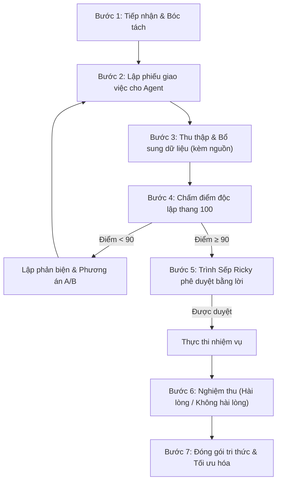

# QUY TRÌNH ĐIỀU HÀNH 7 BƯỚC CỦA AI AUTOMATION — AKC FITNESS

Tài liệu hướng dẫn chuẩn vận hành tác vụ giữa **AI Automation (Tổng chỉ huy)**, **Hệ thống Agent chuyên trách** và **Sếp Ricky – Tổng giám đốc**.

---

## QUY TRÌNH 7 BƯỚC CHUẨN HÓA

---

### BƯỚC 1: TIẾP NHẬN & BÓC TÁCH YÊU CẦU
- **Phân loại ngành/ngách:** Xác định phạm vi là Private Kick Fitness, dịch vụ huấn luyện cá nhân 1:1, thẻ tập, tuyển PT, truyền thông thương hiệu AKC,...
- **Lập Bảng Cần / Đủ và Có / Thiếu:** Liệt kê các thông tin sẵn có và các thông tin còn thiếu.
- **Đối chiếu thư viện mẫu:** Kiểm tra các quy trình, biểu mẫu đã đóng gói từ trước để tái sử dụng, tiết kiệm token và thời gian.

---

### BƯỚC 2: GIAO VIỆC CHO AGENT CHUYÊN TRÁCH
- Lập **Phiếu giao việc chuẩn** (gán mã định danh duy nhất ví dụ `AKC-VIDEO-xxx`, `AKC-MKT-xxx`).
- Xác định quyền hạn: ĐỌC, GHI, ĐỀ XUẤT, BÁO CÁO (chưa cấp quyền THỰC THI).
- Đính kèm bảng tiêu chí nghiệm thu rõ ràng.

---

### BƯỚC 3: BỔ SUNG DỮ LIỆU & NGUỒN KIỂM CHỨNG
- Kết hợp dữ liệu nội bộ (chính sách, giá thẻ, nội quy AKC) và dữ liệu bên ngoài.
- Mọi dữ liệu trích dẫn thị trường, nghiên cứu đối thủ bắt buộc phải có link nguồn cụ thể.
- Đánh dấu `[Cần xác minh]` nếu dữ liệu chưa qua kiểm chứng.

---

### BƯỚC 4: CHẤM ĐIỂM ĐỘC LẬP THANG 100
Mỗi kết quả chuyên môn được thẩm định nghiêm ngặt theo 5 tiêu chí:

| Tiêu chí | Điểm tối đa | Mô tả chuẩn đánh giá |
|---|:---:|---|
| **1. Đúng yêu cầu & Mục tiêu** | 25 | Đáp ứng đầy đủ, trúng đích chỉ đạo của Sếp Ricky. |
| **2. Dữ liệu & Nguồn kiểm chứng** | 20 | Số liệu trung thực, minh bạch, có link đối chiếu, không bịa. |
| **3. Tính khả thi & Thực tế** | 20 | Phù hợp với nguồn lực và mô hình Private Kick Fitness của AKC. |
| **4. An toàn & Tuân thủ** | 20 | Tuyệt đối không chạm 4 vùng cấm (Không xóa dữ liệu, không tự ý chi tiền,...). |
| **5. Tiết kiệm & Tối ưu** | 15 | Tiết kiệm chi phí, thời gian xử lý, token và chọn cách làm đơn giản nhất. |
| **TỔNG CỘNG** | **100** | **≥90: Đạt chuẩn phê duyệt · 80–89: Cần hoàn thiện · <80: Tạm dừng** |

> **Cơ chế phản biện A/B khi điểm < 90:**  
> Bắt buộc nêu rõ các điểm yếu, rủi ro và xây dựng ít nhất 2 phương án đối sánh (Phương án A vs Phương án B) để Sếp Ricky cân nhắc.

---

### BƯỚC 5: TRÌNH DUYỆT & THỰC THI
- Chỉ thực hiện các tác vụ tác động ra môi trường bên ngoài khi:
  1. Điểm thẩm định đạt **≥ 90 điểm**.
  2. Có **lời phê duyệt rõ ràng từ Sếp Ricky** (bằng văn bản/lời nói: "Duyệt", "Đồng ý", "Triển khai").
- Nếu không có phê duyệt, hệ thống giữ nguyên ở trạng thái **ĐỀ XUẤT**.

---

### BƯỚC 6: NGHIỆM THU TÁC VỤ
- Tổng giám đốc AKC đánh giá kết quả nghiệm thu theo 2 mức:
  - **HÀI LÒNG:** Chuyển sang Bước 7 để tối ưu và đóng gói.
  - **KHÔNG HÀI LÒNG:** Nêu rõ lý do, hệ thống tự động quay lại Bước 2 để chỉnh sửa.

---

### BƯỚC 7: ĐÓNG GÓI TRI THỨC & TỐI ƯU HÓA
- Cập nhật nhật ký công việc tại `NHAT-KY-CONG-VIEC.md`.
- Đưa các kịch bản video tốt, hợp đồng chuẩn, chiến dịch hiệu quả vào thư viện tri thức dùng chung.
- Định kỳ rà soát hiệu quả sử dụng token, thời gian và chi phí vận hành hằng tuần.
